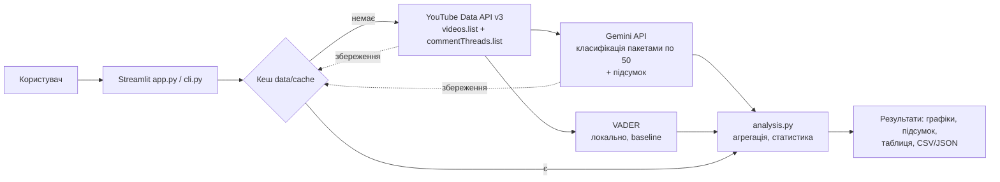
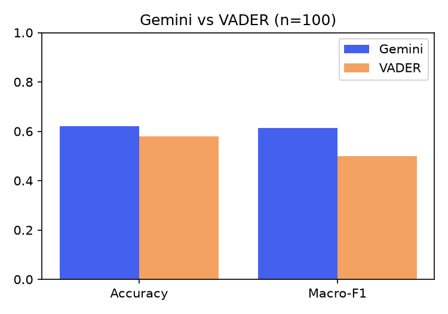
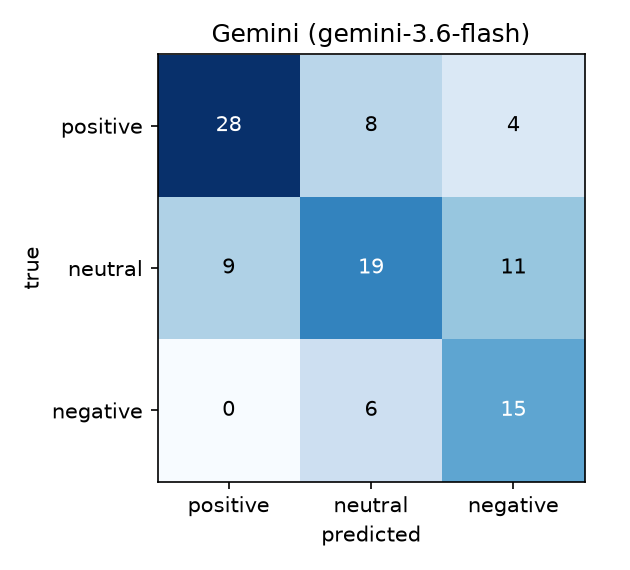
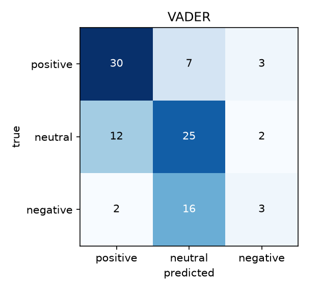

# CommentLens — аналізатор коментарів YouTube

Лабораторна робота №2 з дисципліни «Хмарні обчислення» (КНУ). Proof-of-concept, що поєднує два хмарні API:
**YouTube Data API v3** (дані) і **Gemini API** (класифікація та підсумок за допомогою LLM).

## Що робить проєкт

На вході — посилання на відео YouTube. На виході — аналіз коментарів:

- тональність кожного коментаря (позитивна / нейтральна / негативна);
- тема коментаря (1–3 слова українською), питання до автора, токсичність;
- розподіл тональності й топ тем на графіках;
- короткий підсумок «що думає аудиторія» (4–6 пунктів) і топ-5 питань/прохань глядачів;
- порівняння з базовим підходом VADER (як у проєкті минулого року
  [YARA-SENPAI/cloud_computing_project](https://github.com/YARA-SENPAI/cloud_computing_project));
- експорт у CSV / JSON.

Коментарі можуть бути будь-якою мовою — Gemini класифікує оригінальний текст без перекладу.

**Де це корисно:**
- **авторам** — швидко зрозуміти реакцію аудиторії та знайти питання, на які варто відповісти;
- **маркетингу** — відстежувати сприйняття продукту в оглядах;
- **модерації** — знаходити токсичні коментарі;
- **дослідникам** — збирати й розмічати корпуси коментарів.

## Використані API

### YouTube Data API v3
| Метод | Для чого | Вартість квоти |
|---|---|---|
| `commentThreads.list` | коментарі верхнього рівня, 100 на сторінку, `order=relevance`, `textFormat=plainText`, пагінація через `nextPageToken` | 1 одиниця за запит |
| `videos.list` | назва, канал, перегляди, кількість коментарів | 1 одиниця |
| `search.list` | лише для вибору демо-відео | 100 одиниць |

Стандартна денна квота — 10 000 одиниць, тож аналіз 500 коментарів (5 + 1 = 6 одиниць) практично безкоштовний.
Запити — звичайний `requests`, без важкої клієнтської бібліотеки.

### Gemini API (`google-genai` SDK)
- Модель: **`gemini-3.6-flash`** (обрано через `client.models.list()`: найновіша стабільна Flash-модель, що
  стабільно відповідала; `gemini-2.5-flash` недоступна для нових користувачів, а 3.7/3.8 на момент перевірки
  повертали 503 «high demand»). Можна змінити через `GEMINI_MODEL` у `.env`.
- **Structured output**: `response_mime_type="application/json"` + pydantic-схема (`response_schema`),
  `temperature=0`. Коментарі надсилаються пакетами по 50 → 300 коментарів = 6 запитів + 1 запит на підсумок.
- **Free tier**: обмеження на кількість запитів за хвилину/добу (актуальні цифри —
  [ai.google.dev/gemini-api/docs/rate-limits](https://ai.google.dev/gemini-api/docs/rate-limits)).
  Тому між пакетами є пауза, а на 429 / 5xx — повтори з експоненційною затримкою з урахуванням `retryDelay`.

## Архітектура



Структура коду:

```
app.py                  # Streamlit UI
cli.py                  # python cli.py analyze <url> --max 300
make_labeling_set.py    # вибірка коментарів для ручної розмітки
label_tool.py           # Streamlit-інструмент для розмітки (по одному коментарю)
evaluate.py             # Gemini vs VADER на розмічених даних
commentlens/
  config.py             # .env, константи
  youtube_client.py     # extract_video_id, fetch_video_info, fetch_comments
  gemini_classifier.py  # схема, пакети, повтори, підсумок
  vader_baseline.py
  analysis.py           # агрегація, метрики, пайплайн
  cache.py
tests/                  # pytest, усе офлайн з моками
```

**Надійність:** повтори на 429/5xx; якщо Gemini повернула зіпсований або неповний пакет — один повтор, потім
відсутні коментарі позначаються `unknown` (без падіння). Зрозумілі повідомлення українською для некоректного
посилання, вимкнених коментарів (`commentsDisabled`), неіснуючого відео, вичерпаної квоти (`quotaExceeded`)
та відео без коментарів. Сирі коментарі й класифікації кешуються в `data/cache/`
(ключ: id відео + модель + N), тож повторний запуск миттєвий і не витрачає квоту.
Вимірюються час YouTube, час Gemini, кількість запитів, токени (з `usage_metadata`) і загальний час.

## Встановлення та запуск

1. **Google Cloud проєкт:** [console.cloud.google.com](https://console.cloud.google.com) → створити проєкт.
2. **Увімкнути YouTube Data API v3:** APIs & Services → Library → «YouTube Data API v3» → Enable.
3. **Створити API-ключ:** APIs & Services → Credentials → Create credentials → API key.
   Потім **Edit API key → API restrictions → Restrict key → YouTube Data API v3**.
4. **Ключ Gemini:** [aistudio.google.com](https://aistudio.google.com) → Get API key.
5. **`.env`** у корені проєкту (шаблон — `.env.example`):
   ```
   YOUTUBE_API_KEY=...
   GEMINI_API_KEY=...
   GEMINI_MODEL=          # необов'язково, за замовчуванням gemini-3.6-flash
   ```
6. **Середовище:**
   ```
   python -m venv .venv
   .venv\Scripts\activate
   pip install -r requirements.txt
   ```
7. **Запуск:**
   ```
   streamlit run app.py                                   # веб-інтерфейс
   python cli.py analyze <url> --max 300                  # CLI → reports/<id>.csv/.json
   pytest                                                 # тести (без мережі й ключів)

   python make_labeling_set.py <url1> <url2> <url3> --n 100 --seed 42
   streamlit run label_tool.py --server.port 8502         # ручна розмітка → data/labeling/labeled.csv
   python evaluate.py data/labeling/labeled.csv           # метрики → results/
   ```

## Безпека

- Ключі зберігаються лише в `.env`, який внесено до `.gitignore` (разом із `.venv/`, `data/cache/` тощо) і
  ніколи не комітиться; у репозиторії — тільки `.env.example` з порожніми значеннями.
- Ключ YouTube обмежений лише YouTube Data API v3 — навіть у разі витоку ним не можна користуватися
  іншими сервісами проєкту Google Cloud.
- Код не друкує й не логує ключі.

## Результати

### Демо-відео (`data/demo_videos.json`)
| Відео | Мова | Чому обрано |
|---|---|---|
| [If I Was Starting My Style Over, I'd Buy These 5 Things](https://www.youtube.com/watch?v=w224tgfrTBY) — mindofgabe | en | основне відео (усього 11 коментарів верхнього рівня) |
| [Огляд Xiaomi 15T та Xiaomi 15T Pro](https://www.youtube.com/watch?v=oBfpEReuB3o) — Andro-news.com | uk | українськомовне, 700+ коментарів |
| [Car Mechanic Reviews The Tesla CyberTruck! Breakthrough or Super Gimmick?](https://www.youtube.com/watch?v=pi7Ec9APt7s) — The Car Care Nut Reviews | en | поляризовані реакції |

Приклад продуктивності (100 коментарів, 1-ше відео): YouTube 0.6 с, Gemini 7.2 с (2 запити, ~1.8 тис. токенів);
повторний запуск з кешу — 0.02 с.

### Оцінка якості: Gemini vs VADER
100 коментарів (10 / 45 / 45 з трьох відео; у першому відео більше немає), розмічених вручну:
40 positive, 39 neutral, 21 negative.

| Метрика | Gemini (gemini-3.6-flash) | VADER |
|---|---|---|
| Accuracy | **0.620** | 0.580 |
| Macro-F1 | **0.614** | 0.499 |
| F1 positive (P/R) | **0.73** (0.76/0.70) | 0.71 (0.68/0.75) |
| F1 neutral (P/R) | 0.53 (0.58/0.49) | **0.57** (0.52/0.64) |
| F1 negative (P/R) | **0.59** (0.50/0.71) | 0.21 (0.38/0.14) |

| Відео | n | Gemini acc | VADER acc |
|---|---|---|---|
| Xiaomi 15T (uk) | 45 | **0.60** | 0.47 |
| Cybertruck (en) | 45 | 0.58 | **0.67** |
| mindofgabe (en) | 10 | **0.90** | 0.70 |

Gemini на 100 коментарях: 2 запити, ~34 с, ~9 тис. токенів.



| Gemini | VADER |
|---|---|
|  |  |

### Висновки
- **Негативні коментарі — головна перевага Gemini.** VADER знаходить лише 3 з 21 негативного
  (recall 0.14), Gemini — 15 (recall 0.71). Звідси велика різниця в Macro-F1 (0.61 vs 0.50).
- **Українська мова.** VADER — англомовний словниковий метод і на українському відео майже все вважає
  нейтральним (accuracy 0.47); Gemini працює з оригінальним текстом (0.60).
- **Де Gemini програє.** На відео про Cybertruck VADER точніший (0.67 vs 0.58). Більшість помилок Gemini там —
  різке ставлення до *продукту* («What a piece of crap overpriced vehicle 😂», «Hideous design»), яке Gemini
  оцінює як negative, а в ручній розмітці воно позначене positive/neutral. Тобто різниця частково в тому,
  *що саме* вважається тональністю (ставлення до автора/відео чи до предмета огляду). Інструкція для Gemini
  цього не уточнює — це очевидне місце для покращення промпту.
- **Обмеження оцінки:** лише 100 коментарів, один розмітник, різниця в accuracy (0.62 vs 0.58) невелика й
  у межах похибки на такій вибірці; переконливою є лише перевага на негативному класі. При
  `temperature=0` результати Gemini між запусками все одно трохи варіюються (accuracy 0.63 → 0.62 при
  повторному запуску).
- Крім тональності, Gemini дає те, чого VADER не вміє взагалі: теми, питання, токсичність і підсумок.

Приклади, де VADER помиляється, а Gemini — ні: [`results/disagreements.csv`](results/disagreements.csv) (22 шт.);
усі передбачення — [`results/predictions.csv`](results/predictions.csv); метрики — `results/metrics.json`,
`results/metrics.md`.
